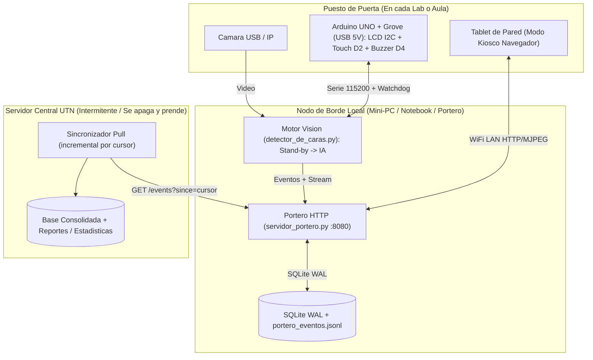

# Registro de Decisión Arquitectural (ADR) 007: Hoja de Ruta de Despliegue Físico, Anti-Spoofing y Escalabilidad

- **Fecha:** 2026-11-12
- **Estado:** Propuesto / Planificación Activa
- **Contexto:** Plataforma de Control de Acceso y Telemetría del LIS (UTN FRC)
- **Alcance:** Transición desde prototipo de escritorio hacia nodo productivo en el LIS, con proyección de réplica a otros laboratorios y aulas de la facultad.

---

## 1. Prioridad Central: Núcleo Cámara + Entrada/Salida

El eje principal de valor del sistema es que el ciclo **Cámara $\rightarrow$ Identificación $\rightarrow$ Registro de Entrada/Salida** sea rápido, preciso e infalible en condiciones reales de puerta:

- **Modo Laboratorio (LIS y afines):** Flujo de 1 persona por vez con confirmación explícita (**Touch `D2` + Rostro + Gesto Palma/Pulgar**) para evitar falsos registros de transeúntes y asentar con precisión entrada vs. salida.
- **Modo Aula (proyección futura a cursado masivo):** Flujo continuo de alta velocidad (40–80 alumnos ingresando en pocos minutos) sin exigir sostener gesto por persona, priorizando velocidad de registro de ingreso.

---

## 2. Diagrama de Despliegue y Resiliencia Energética

### Decisiones operativas para cortes de energía y servidores intermitentes
1. **Auto-arranque desatendido:** Configurar servicio `systemd` (Linux) o tarea de inicio (Windows) en el Nodo de Borde para levantar Portero + Visión automáticamente al encender el equipo tras un corte de luz.
2. **Gestión USB y energía:** Desactivar la suspensión selectiva USB (`usbcore.autosuspend=-1` en Linux) para que el kernel no duerma el Arduino ni la webcam durante períodos largos de Stand-by.
3. **Arduinos:** Alimentados por USB 5V desde el Nodo de Borde; al regresar la energía arrancan en Stand-by (`1.7 s`) y el *watchdog* serie de [`hardware/serie.py`](../../hardware/serie.py) los reconecta en caliente.
4. **Tablet de pared:** Navegador en modo Kiosco apuntando al Nodo de Borde local (`http://IP_NODO:8080/tablero`), con límite de carga al 80% (o corte nocturno programado) para evitar degradación de batería por conexión 24/7.
5. **Servidores que se apagan y prenden:** SQLite en modo WAL + `portero_eventos.jsonl` (*append-only*) garantizan cero corrupción ante cortes bruscos. Cuando el servidor central vuelve a encenderse, sincroniza por *pull* (`GET /events?since=cursor`) sin duplicar eventos. Se valida `reloj_confiable` (NTP/RTC) en cada arranque.

---

## 3. Seguridad Anti-Spoofing (Foto / Pantalla vs. Rostro Real) y Sensores

- **Amenaza:** Presentar una fotografía impresa o la pantalla de un celular frente a la cámara mientras otra mano realiza el gesto lateralmente.
- **Estrategia de mitigación por visión (sin hardware costoso):**
  1. **Geometría 3D y micro-dinámica con `FaceLandmarker` (468 puntos ya disponibles):** Verificar profundidad relativa $Z$ (nariz vs. pómulos/ojos) y parpadeo natural (*Eye Aspect Ratio*) / micro-variación de pose entre cuadros.
  2. **Clasificador Anti-Spoofing liviano (ej. *MiniFASNet* en ONNX, ~2 MB):** Detección en CPU (`< 10 ms`) de textura de papel, patrones *moiré* y reflejos especulares de pantallas.
- **Rol de los sensores físicos:**
  - El **Touch (`D2`)** cumple un rol intencional (confirma presencia física en el puesto y despierta la IA), pero no reemplaza la prueba de vida visual.
  - Se descarta agregar sensores ultrasónicos o PIR para despertar la cámara en pasillos por la alta tasa de falsos disparos al pasar caminando.

---

## 4. Escalabilidad Vectorial (`sqlite-vec`)

- **Situación actual (1 laboratorio, < 100 perfiles):** Comparación vectorizada en RAM con NumPy (`< 1 ms`).
- **Escalamiento a múltiples laboratorios y aulas (500 a 5.000+ perfiles):** Incorporar la extensión C **`sqlite-vec`** (`vec0`) dentro de `lis_maestra.db` para ejecutar búsquedas KNN directas en SQL en sub-milisegundos, filtrando por sede/laboratorio/resolución sin cargar decenas de miles de vectores en RAM.

---

## 5. Estrategia de Pruebas a Escala (Datasets Multi-Pose y Multitud Sintética)

Antes de desplegar en aulas o incorporar `sqlite-vec`, se planifica un **banco de pruebas aislado** sobre una base SQLite temporal (nunca sobre `datos/lis_maestra.db`) combinando rostros reales con múltiples poses y carga sintética:

1. **Alternativa 1 — LFW (*Labeled Faces in the Wild*) vía `scikit-learn` (Prioritaria):**
   - Carga automática con `fetch_lfw_people(min_faces_per_person=5, color=True, resize=1.0)` (~200 MB), filtrando únicamente identidades con al menos 5 fotos/poses distintas.
   - Se enrolan 3–5 poses por persona a través del extractor real (`ExtractorFaceNetRapido` / `vggface2`) y se evalúan las fotos restantes junto con capturas reales del LIS mezcladas en esa multitud (150–400+ identidades).
2. **Alternativa 2 — CPLFW (*Cross-Pose LFW*):**
   - Subconjunto curado de 3.000 pares positivos con cambios marcados de ángulo (*yaw* / *pitch*) y pares negativos difíciles, ideal para validar la calibración actual (`metodo_comparacion = "minimo"`, `umbral = 0.68`, margen de Lowe `0.04`).
3. **Alternativa 3 — Carga Sintética / Híbrida ($N = 500$ a $5.000+$ identidades):**
   - Para medir rendimiento puro de base de datos, replicar o generar $K = 5$ vectores unitarios $L_2$-normalizados en $\mathbb{R}^{512}$ por identidad (dispersión $\sigma \approx 0.15$) más miles de eventos `entrada`/`salida`.
4. **Métricas a medir en el benchmark:**
   - **Latencia de consulta (`ms`):** Tiempo de matching por frame comparando NumPy en RAM vs. `sqlite-vec`.
   - **Tasa de Falsos Positivos (FAR) / Falsos Rechazos (FRR)** y comportamiento del **Margen de Lowe** al crecer la galería.
   - **Consumo de RAM y estrés de eventos:** Impacto en `/state`, SQLite WAL y sincronización CSV/JSONL.

