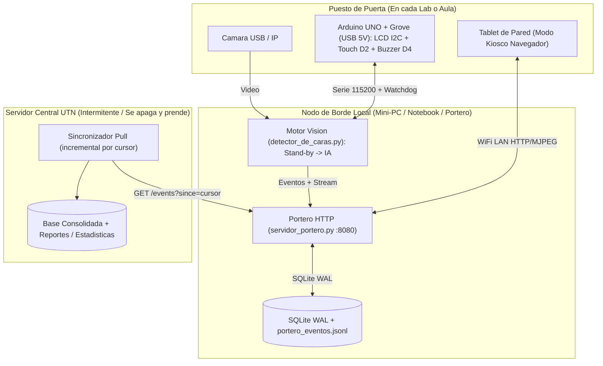

# Registro de Decisión Arquitectural (ADR) 007: Hoja de Ruta de Despliegue Físico, Anti-Spoofing y Escalabilidad

- **Fecha:** 2026-11-12
- **Estado:** Propuesto / Planificación Activa
- **Contexto:** Plataforma de Control de Acceso y Telemetría del LIS (UTN FRC)
- **Alcance:** Transición desde prototipo de escritorio hacia nodo productivo en el LIS, con proyección de réplica a otros laboratorios y aulas de la facultad.

---

## 1. Prioridad Central: Núcleo Cámara + Entrada/Salida

El eje principal de valor del sistema es que el ciclo **Cámara $\rightarrow$ Identificación $\rightarrow$ Registro de Entrada/Salida** sea rápido, preciso e infalible en condiciones reales de puerta:

- **Modo Laboratorio (LIS y afines):** Flujo de 1 persona por vez con confirmación explícita (**Touch `D2` + Rostro + Gesto Palma/Pulgar**) para evitar falsos registros de transeúntes y asentar con precisión entrada vs. salida.
- **Modo Aula (proyección futura a cursado masivo):** Flujo continuo de alta velocidad (40–200 alumnos ingresando en pocos minutos) sin exigir sostener gesto por persona, priorizando velocidad de registro de ingreso.

### 1.1 Diseño de "Modo Aula": Asistencia de 100–200 Alumnos sin Cuenta Previa y Asociación con Padrón (Nombre, Apellido, Legajo)

En un aula masiva con fila de 100–200 estudiantes que no tienen cuenta ni perfil biométrico previo, pedir registro manual en la puerta colapsaría el ingreso. Para resolver este arranque en frío (*cold-start*) sin detener la fila se combinan tres etapas:

1. **Etapa 0 — Precarga del Padrón Oficial (CSV de Autogestión / SIU-Guaraní):**
   - Antes de iniciar el cuatrimestre, el docente importa el CSV oficial de la comisión (`legajo, apellido, nombre`).
   - El sistema genera las fichas administrativas válidas y sin errores de tipeo, con `cantidad_embeddings = 0` (estado: *Pendiente de vinculación biométrica*).
2. **Mecanismo A — Auto-Onboarding Web / QR desde el Celular del Alumno (Fricción Cero en Puerta):**
   - El docente proyecta un enlace/QR en el pizarrón (o lo publica en el Aula Virtual). Cada alumno accede desde su celular, ingresa su **Legajo**, confirma su nombre y apellido precargados y realiza la captura guiada de 3–5 poses en ~15 segundos.
   - El servidor extrae los embeddings `vggface2` en RAM y descarta las fotos crudas.
   - Al cruzar por la puerta en **Modo Aula (Paso Continuo)** no hace falta tocar `D2` ni hacer gesto: alcanza con mirar hacia la cámara durante `2–3 frames` estables ($\approx 150\text{ ms}$) mientras la tablet muestra la lista rodante de reconocidos (`✅ 89412 - Pérez, Juan`).
3. **Mecanismo B — Asistencia Anónima por Clustering Temporal + Reconciliación Diferida (Alumnos que llegan sin enrolarse):**
   - Si un alumno pasa por la puerta y su rostro no coincide con la galería (`distancia > 0.68`), **nunca se detiene la fila**.
   - El nodo agrupa la cara estable en una **Identidad Temporal de Clase** (`aula_temp_001`, `aula_temp_002`, ...) guardando su vector `float32` de 512 dimensiones, el timestamp exacto de ingreso y un código corto de referencia en pantalla (ej. `Ticket #042`).
   - **Asociación posterior al alumno real (Nombre, Apellido, Legajo):**
     - *Reconciliación biométrica automática:* cuando ese alumno finalmente se enrola (desde su celular en el aula, al salir o en la clase siguiente) vinculando su rostro a su **Legajo**, el sistema ejecuta un cruce vectorial (`consultar_embeddings` con umbral estricto `< 0.58`) contra las identidades huérfanas `aula_temp_*` de la comisión y le adjudica retroactivamente sus asistencias previas.
     - *Vinculación rápida de 1 toque en el Kiosco:* mediante el teclado numérico de hasta 12 dígitos (`#modal-pin-kiosco`), el alumno ingresa su **Legajo** mirando a la cámara ~2 segundos; el sistema guarda sus embeddings en ese acto y lo vincula a su ficha oficial del padrón para el resto del año.

---

## 2. Diagrama de Despliegue y Resiliencia Energética

### Decisiones operativas para cortes de energía y servidores intermitentes
1. **Auto-arranque desatendido:** Configurar servicio `systemd` (Linux) o tarea de inicio (Windows) en el Nodo de Borde para levantar Portero + Visión automáticamente al encender el equipo tras un corte de luz.
2. **Gestión USB y energía:** Desactivar la suspensión selectiva USB (`usbcore.autosuspend=-1` en Linux) para que el kernel no duerma el Arduino ni la webcam durante períodos largos de Stand-by.
3. **Arduinos:** Alimentados por USB 5V desde el Nodo de Borde; al regresar la energía arrancan en Stand-by (`1.7 s`) y el *watchdog* serie de [`hardware/serie.py`](../../hardware/serie.py) los reconecta en caliente.
4. **Tablet de pared:** Navegador en modo Kiosco apuntando al Nodo de Borde local (`http://IP_NODO:8080/tablero`), con límite de carga al 80% (o corte nocturno programado) para evitar degradación de batería por conexión 24/7.
5. **Servidores que se apagan y prenden:** SQLite en modo WAL + `portero_eventos.jsonl` (*append-only*) garantizan cero corrupción ante cortes bruscos. Cuando el servidor central vuelve a encenderse, sincroniza por *pull* (`GET /events?since=cursor`) sin duplicar eventos. Se valida `reloj_confiable` (NTP/RTC) en cada arranque.

---

## 3. Seguridad Anti-Spoofing (Foto / Pantalla vs. Rostro Real) y Sensores

- **Amenaza:** Presentar una fotografía impresa o la pantalla de un celular frente a la cámara mientras otra mano realiza el gesto lateralmente.
- **Estrategia de mitigación por visión (sin hardware costoso):**
  1. **Geometría 3D y micro-dinámica con `FaceLandmarker` (468 puntos ya disponibles):** Verificar profundidad relativa $Z$ (nariz vs. pómulos/ojos) y parpadeo natural (*Eye Aspect Ratio*) / micro-variación de pose entre cuadros.
  2. **Clasificador Anti-Spoofing liviano (ej. *MiniFASNet* en ONNX, ~2 MB):** Detección en CPU (`< 10 ms`) de textura de papel, patrones *moiré* y reflejos especulares de pantallas.
- **Rol de los sensores físicos:**
  - El **Touch (`D2`)** cumple un rol intencional (confirma presencia física en el puesto y despierta la IA), pero no reemplaza la prueba de vida visual.
  - Se descarta agregar sensores ultrasónicos o PIR para despertar la cámara en pasillos por la alta tasa de falsos disparos al pasar caminando.

---

## 4. Escalabilidad Vectorial (`sqlite-vec`)

- **Situación actual (1 laboratorio, < 100 perfiles):** Comparación vectorizada en RAM con NumPy (`< 1 ms`).
- **Escalamiento a múltiples laboratorios y aulas (500 a 5.000+ perfiles):** Incorporar la extensión C **`sqlite-vec`** (`vec0`) dentro de `lis_maestra.db` para ejecutar búsquedas KNN directas en SQL en sub-milisegundos, filtrando por sede/laboratorio/resolución sin cargar decenas de miles de vectores en RAM.

---

## 5. Estrategia de Pruebas a Escala (Datasets Multi-Pose y Multitud Sintética)

Antes de desplegar en aulas o incorporar `sqlite-vec`, se planifica un **banco de pruebas aislado** sobre una base SQLite temporal (nunca sobre `datos/lis_maestra.db`) combinando rostros reales con múltiples poses y carga sintética:

1. **Alternativa 1 — LFW (*Labeled Faces in the Wild*) vía `scikit-learn` (Prioritaria):**
   - Carga automática con `fetch_lfw_people(min_faces_per_person=5, color=True, resize=1.0)` (~200 MB), filtrando únicamente identidades con al menos 5 fotos/poses distintas.
   - Se enrolan 3–5 poses por persona a través del extractor real (`ExtractorFaceNetRapido` / `vggface2`) y se evalúan las fotos restantes junto con capturas reales del LIS mezcladas en esa multitud (150–400+ identidades).
2. **Alternativa 2 — CPLFW (*Cross-Pose LFW*):**
   - Subconjunto curado de 3.000 pares positivos con cambios marcados de ángulo (*yaw* / *pitch*) y pares negativos difíciles, ideal para validar la calibración actual (`metodo_comparacion = "minimo"`, `umbral = 0.68`, margen de Lowe `0.04`).
3. **Alternativa 3 — Carga Sintética / Híbrida ($N = 500$ a $5.000+$ identidades):**
   - Para medir rendimiento puro de base de datos, replicar o generar $K = 5$ vectores unitarios $L_2$-normalizados en $\mathbb{R}^{512}$ por identidad (dispersión $\sigma \approx 0.15$) más miles de eventos `entrada`/`salida`.
4. **Métricas a medir en el benchmark:**
   - **Latencia de consulta (`ms`):** Tiempo de matching por frame comparando NumPy en RAM vs. `sqlite-vec`.
   - **Tasa de Falsos Positivos (FAR) / Falsos Rechazos (FRR)** y comportamiento del **Margen de Lowe** al crecer la galería.
   - **Consumo de RAM y estrés de eventos:** Impacto en `/state`, SQLite WAL y sincronización CSV/JSONL.

### 5.1 Resultados Experimentales del Benchmark a Escala (`nucleo/benchmark_escala.py`)

Se implementó `IndiceEmbeddingsRAM` en [`nucleo/comparacion.py`](../../nucleo/comparacion.py) y el banco aislado [`nucleo/benchmark_escala.py`](../../nucleo/benchmark_escala.py) (ejecutado sobre bases SQLite temporales y leyendo en modo solo-lectura `mode=ro` el perfil real `Jonas` de 5 poses en `vggface2`). Con los parámetros productivos (`umbral = 0.68`, `metodo = "minimo"`, `margen_separacion = 0.04`):

| Personas | Vectores | Carga SQLite (ms) | Índice RAM (ms) | Bucle Python (ms) | IndiceEmbeddingsRAM (ms) | Aceleración | TAR Sint. | FAR Imp. | Real LOPO (`Jonas`) | Dist. Real | 2do Cand. | Margen Lowe |
|---:|---:|---:|---:|---:|---:|---:|---:|---:|:---:|---:|---:|---:|
| 50 | 250 | 4.56 | 4.82 | 3.826 | 1.519 | 2.5x | 100.0% | 0.0% | 5/5 | 0.2796 | 1.3446 | 1.0649 |
| 200 | 1000 | 10.54 | 20.39 | 18.026 | 2.694 | 6.7x | 100.0% | 0.0% | 5/5 | 0.2796 | 1.3051 | 1.0254 |
| 500 | 2500 | 27.24 | 64.62 | 48.568 | 3.810 | 12.8x | 100.0% | 0.0% | 5/5 | 0.2796 | 1.3101 | 1.0305 |
| 1000 | 5000 | 37.20 | 97.41 | 85.981 | 5.858 | 14.7x | 100.0% | 0.0% | 5/5 | 0.2796 | 1.3108 | 1.0311 |
| 2500 | 12500 | 111.00 | 306.84 | 209.928 | 11.702 | 17.9x | 100.0% | 0.0% | 5/5 | 0.2796 | 1.2905 | 1.0108 |
| 5000 | 25000 | 204.65 | 576.61 | 424.962 | 21.967 | 19.4x | 100.0% | 0.0% | 5/5 | 0.2796 | 1.2954 | 1.0157 |

**Conclusiones empíricas:**
- Hasta **1.000 personas (5.000 vectores)** —equivalente a varios laboratorios o varias comisiones de aula juntas—, `IndiceEmbeddingsRAM` consulta en **5.86 ms** (`14.7x` más rápido que el bucle tradicional de `85.98 ms`) sin requerir aún `sqlite-vec`.
- Recién a partir de **2.500–5.000 identidades (12.500–25.000 vectores)** la consulta en RAM sube a `11.7–22.0 ms`, momento en el que `sqlite-vec` (`vec0`) cobra sentido si se centraliza toda la facultad en un único índice sin filtrar por comisión/sede.
- Incluso mezclado entre **5.000 identidades aleatorias**, el perfil real `Jonas` mantuvo **5/5 aciertos Leave-One-Pose-Out** con un margen de Lowe medio de `1.0157` (muy por encima del mínimo `0.04`).
- Para evaluar también variaciones reales de pose e iluminación humana en casa, queda disponible `/home/jonas/.venv-ml/bin/python -m nucleo.benchmark_escala --lfw`.

---

## 6. Adaptación Continua en Uso y Roadmap de Implementación

Tras evaluar las alternativas mediante un análisis multi-perspectiva (*LLM Council*), se descartaron `SGDClassifier (partial_fit)`, el promedio móvil `EMA` y las mutaciones silenciosas gatilladas por PIN. La arquitectura definitiva para este punto queda especificada en [ADR 008: Adaptación Continua en Uso y Límites de Machine Learning](./008-arquitectura-adaptacion-continua-y-limites-ml.md):

- **Búsqueda vectorial pura + filtrado por proyecto:** `IndiceEmbeddingsRAM` (con swap atómico en RAM) + `sqlite-vec` (`vec0`), filtrando por comisión/proyecto en Modo Aula.
- **5 Anclas Inmutables + máx. 3 Slots Adaptativos Discretos:** con TTL (expiración), reemplazo LRU, rollback en 1 comando, **4 compuertas con veto inter-clase** y exclusión de Modo Aula (solo lectura).
- **Top-3 efímero por `PistaRostro` + `telemetria_shadow` pasiva:** fusión ponderada en inferencia sin costo extra de FaceNet y registro numérico pasivo por evento resuelto (sin fotos crudas).

### Roadmap acordado por fases
1. **Fase 1 — Motor Vectorial + Fundaciones de Adaptación Segura (En curso, Casa):** integrar `sqlite-vec` (`vec0`) con fallback a `IndiceEmbeddingsRAM`, crear `nucleo/adaptacion.py` (Buffer Top-3 por pista, 4 compuertas con veto inter-clase, detector de alerta ambiental), extender `RepositorioLIS` (5 anclas + 3 slots con TTL/rollback, filtro por `proyecto` y `telemetria_shadow` pasiva) y mostrar 2do candidato + margen de Lowe en el HUD.
2. **Fase 2 — Prueba Visual en Tiempo Real con Caras Reales (Casa):** ingesta de caras reales multi-pose de **LFW** en una base de prueba para simular una fila en vivo y probar la webcam propia mezclada entre cientos de rostros humanos reales.
3. **Fase 3 — Seguridad Anti-Spoofing y UI de Actualización Explícita (Casa):** geometría 3D $Z$ y parpadeo/micro-movimiento con `FaceLandmarker` (y evaluación opcional de *MiniFASNet* en ONNX) + botón explícito *"Actualizar perfil (5 s)"* en el Tablero para Modo LIS.
4. **Fase 4 — Gestión, Modo Aula y Resiliencia (Casa):** conectar `05 Estadísticas` a SQLite (`/stats`), implementar Padrón CSV + filtrado por comisión/turno + `aula_temp_*` con reconciliación offline, endpoint incremental `GET /events?since=cursor` y scripts `systemd`/USB en `deploy/`.
5. **Fase 5 — Puesta en Marcha Física (Lab LIS):** instalar servicio desatendido, desactivar suspensión USB y validar soporte físico completo en puerta.

