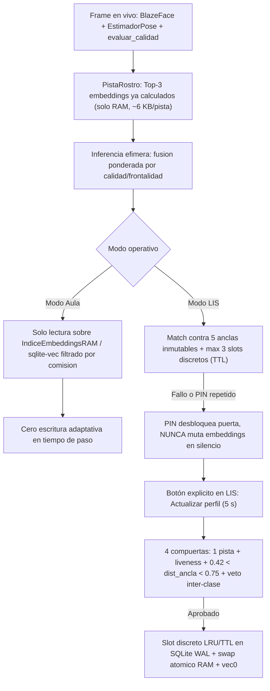

# Registro de Decisión Arquitectural (ADR) 008: Arquitectura de Adaptación Continua en Uso y Límites de Machine Learning

- **Fecha:** 2026-11-19
- **Estado:** Aprobado / En Implementación (Fase 1)
- **Contexto:** Revisión crítica (*LLM Council* de 5 consejeros + 5 revisiones cruzadas anónimas) sobre cómo lograr que el sistema se adapte progresivamente con el uso real sin comprometer la privacidad ni envenenar perfiles en Modo LIS y Modo Aula.
- **Terminología:** Se adopta **"adaptación continua en uso"** en lugar del término de ML *"aprendizaje online"* para evitar confusiones: toda la plataforma opera **100% offline / local** sin depender de conectividad a internet.

---

## 1. Pregunta Evaluada

En [`007-despliegue-anti-spoofing-y-escalabilidad.md`](./007-despliegue-anti-spoofing-y-escalabilidad.md) se había esbozado inicialmente una primera idea con `SGDClassifier (partial_fit)`, media móvil exponencial (`EMA`) y actualización tras el ingreso de PIN. Al revisar los riesgos reales de puerta:
- Capturar una sola foto en el instante de ingresar el PIN es malo ergonómicamente (el usuario mira abajo al teclado de la tablet, se acerca en exceso o queda desenfocado).
- Surgió la contrapropuesta de mantener un buffer circular temporal en RAM cada `0.5s–1s` durante todo el intento para retroalimentar al modelo, y evaluar cómo escala esto tanto al **Modo LIS** (< 100 integrantes) como al **Modo Aula** (100–200 alumnos en fila en minutos; 500–5.000 perfiles en la facultad).

---

## 2. Qué se Descarta Definitivamente (Consenso Unánime)

Tras el análisis geométrico, operativo y de seguridad del Council, se descartan cuatro enfoques:

1. **Descartar `SGDClassifier (partial_fit)`:**
   - Con un extractor congelado (`InceptionResnetV1 / vggface2` de 512 dimensiones), ~5 muestras por persona y hasta 5.000 identidades con altas frecuentes, ajustar hiperplanos lineales incrementales provoca *catastrophic forgetting*, sesgo fuerte hacia quienes fichan todos los días y quiebre al incorporar usuarios o identidades temporales (`aula_temp_*`).
   - El problema pertenece al dominio de recuperación métrica sobre la hiperesfera unitaria (`IndiceEmbeddingsRAM` / `sqlite-vec`), no clasificación lineal supervisada.
2. **Descartar Promedio Móvil Exponencial (`EMA`) y Compuerta `dist < 0.42`:**
   - Actualizar cuando `dist < 0.42` es tautológico: solo refuerza tomas que el modelo ya reconocía sin dificultad y no incorpora cambios reales de apariencia.
   - Promediar con `EMA` vectores de distintos submodos válidos (por ejemplo, persona con anteojos vs. sin anteojos, o barba incipiente) arrastra el centroide hacia una región intermedia vacía de la hiperesfera $S^{511}$, degradando ambos casos.
3. **Descartar Mutación Silenciosa Gatillada por PIN:**
   - En puertas reales de laboratorio es habitual entrar acompañado o compartir el PIN de contingencia. Como **no se almacenan fotos crudas en disco por privacidad**, cualquier embedding contaminado en SQLite resulta inauditable (*template poisoning* silencioso).
   - Asimismo, un buffer circular por reloj (`0.5s–1s`) mezcla caras si otra persona entra en cuadro y consume CPU innecesaria si dispara inferencias adicionales.
4. **Descartar Auto-Adaptación en Vivo en Modo Aula:**
   - Durante el ingreso en fila de 100–200 alumnos hay cruces de trayectorias (*ID-switches* en `PistaRostro`), oclusiones y eventuales préstamos de QR/credenciales. Cualquier escritura adaptativa automática en tiempo de paso corrompería masivamente la galería.

---

## 3. Arquitectura Aprobada

### Decisiones técnicas concretas
1. **Búsqueda vectorial pura con filtro contextual:**
   - Usar **`IndiceEmbeddingsRAM`** en memoria con **swap atómico** ante cambios en galería y **`sqlite-vec` (`vec0`)** para persistencia/consultas KNN nativas en SQLite WAL.
   - En **Modo Aula**, filtrar la galería activa por **comisión / proyecto / turno** (~100–200 inscriptos) en lugar de consultar 5.000 perfiles globales de una sola vez.
2. **5 Anclas Inmutables + Máximo 3 Slots Adaptativos Discretos (con TTL y Rollback):**
   - Cada embedding en SQLite conserva `tipo` (`'ancla'` o `'adaptativo'`), `origen`, `expira_en` (TTL de 90–180 días para adaptativos), `ultimo_uso` y `aciertos`.
   - Las 5 anclas del alta guiada jamás se modifican ni se borran automáticamente; los slots adaptativos capturan submodos discretos reales (lentes, nueva luz, barba) con política LRU sobre `max_slots = 3`.
   - **Reversibilidad determinista en 1 paso:** `revertir_a_anclas()` elimina los slots `adaptativo` sin depender de fotos guardadas.
3. **Buffer efímero Top-3 por `PistaRostro` (sin reloj ni CPU extra):**
   - Cada `PistaRostro` conserva únicamente hasta **3 embeddings ya calculados** por el pipeline que cumplieron `evaluar_calidad` y frontalidad (`|yaw| <= 20°`, `|pitch| <= 15°`).
   - Se utiliza para **fusión multi-frame ponderada en tiempo de inferencia** (mejora la estabilidad de reconocimiento sin ejecutar inferencias FaceNet adicionales) y muere con la pista en RAM.
4. **PIN desacoplado + Actualización explícita con 4 Compuertas y Veto Inter-Clase:**
   - El PIN únicamente autentica/desbloquea y jamás modifica biometría de fondo.
   - Toda promoción de un slot adaptativo en LIS requiere confirmación explícita/liveness y aprobar **4 compuertas**:
     1. Exactamente **1 sola `PistaRostro` activa** en la escena.
     2. **Liveness / gesto** confirmado.
     3. **Calidad geométrica y fotométrica** estricta más banda plausible respecto a las 5 anclas propias: `0.42 < dist_ancla < 0.75`.
     4. **Veto inter-clase:** la distancia del embedding candidato al segundo usuario más cercano de la galería debe cumplir `dist_otro >= max(umbral_seguridad, dist_ancla + 0.12)`.
5. **Detector de Sanidad Ambiental y `telemetria_shadow` pasiva:**
   - Si ≥ 3 usuarios distintos fallan en una ventana de 15 minutos, se emite alerta técnica ambiental (contraluz, lente sucia o cámara desplazada) para evitar compensar fallas de hardware con mutaciones biométricas.
   - La tabla **`telemetria_shadow`** registra de forma pasiva 1 fila numérica liviana por intento resuelto (fichaje con gesto o contingencia por PIN, jamás por cuadro de video ni fotos) con `dist_primero`, `dist_segundo`, `margen`, `calidad`, `pistas_activas` y `decision_shadow` simulada para acumular evidencia empírica sin riesgo.

